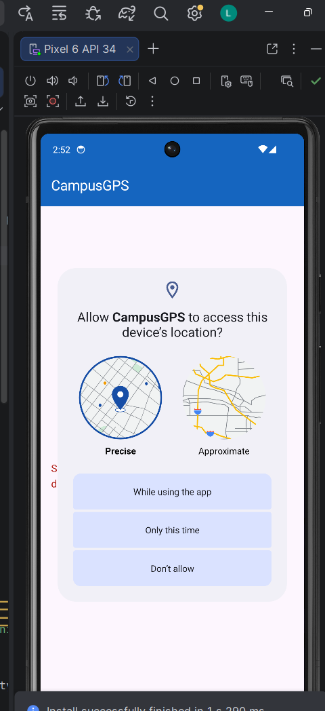
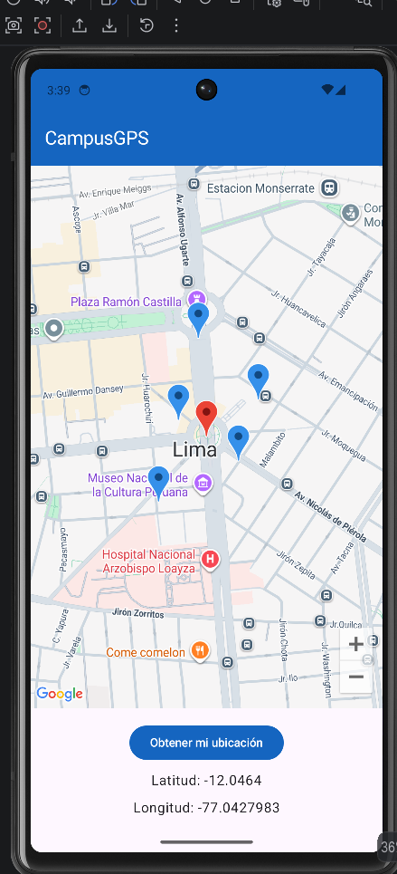
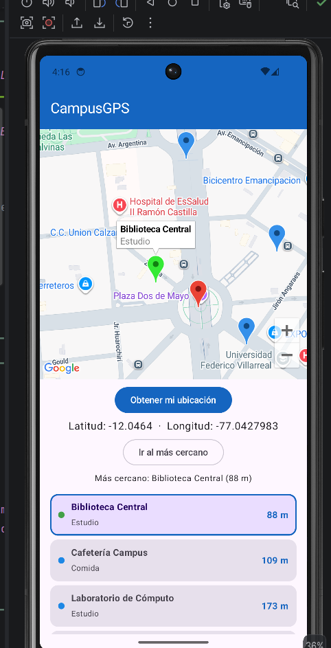
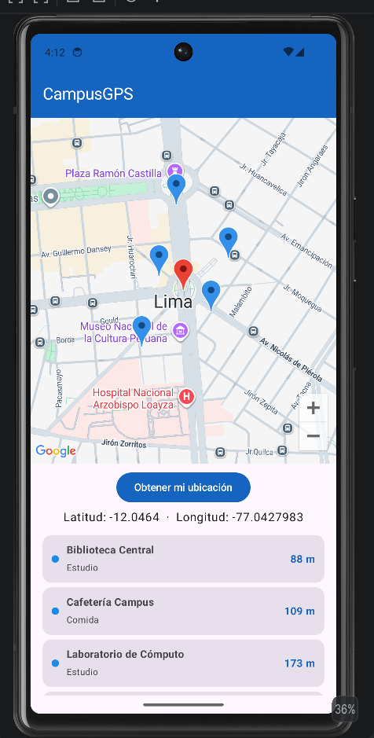
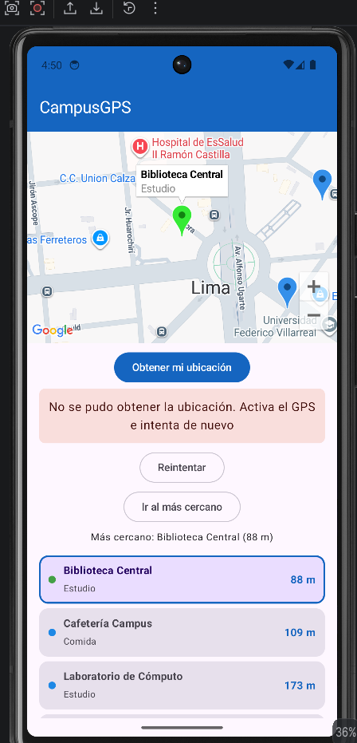

# CampusGPS

App Android que obtiene la ubicación del usuario, la muestra en un mapa de Google junto a 5 lugares del campus y ordena esos lugares por distancia, resaltando el más cercano.

Hecha con Kotlin, Jetpack Compose y Material 3, siguiendo MVVM + Repository.

## Qué hace

- Pide el permiso de ubicación en tiempo de ejecución.
- Obtiene la posición con `FusedLocationProviderClient`.
- Dibuja el mapa con Maps Compose: marcador rojo "Estás aquí" y 5 marcadores de lugares (el más cercano en verde).
- Lista los lugares ordenados de menor a mayor distancia (en m o km).
- Al tocar una tarjeta o un marcador, la cámara viaja al lugar y se resalta.
- Botón "Ir al más cercano".
- Maneja errores: permiso denegado (Abrir ajustes), GPS apagado (Reintentar) y falta de Google Play Services.

## Configuración de la clave de Google Maps

La clave **no está en el repositorio**. Se guarda en `local.properties` (ignorado por git):

```
MAPS_API_KEY=tu_clave_aqui
```

`app/build.gradle.kts` la lee y la inyecta en el Manifest con `manifestPlaceholders`.

## Estructura de paquetes

```
com.vasquez.campusgps
├── MainActivity.kt
├── model/        Modelos.kt (Posicion, Lugar, LugarConDistancia, UbicacionUi, TipoError)
├── data/         UbicacionRepository (interface) + UbicacionRepositoryGoogle
│                 LugaresRepository (interface)   + LugaresRepositoryLocal
├── util/         Distancia.kt, Formato.kt (funciones puras)
├── viewmodel/    MapaViewModel.kt, CampusViewModelFactory.kt
└── ui/           PantallaMapa, MapaUbicacion, ListaLugares, MensajeError
    └── theme/
```

## Arquitectura MVVM + Repository

```
View (PantallaMapa)
   |  evento: pulsar el botón        ^ collectAsState()
   v                                 |
ViewModel (MapaViewModel) --- StateFlow --->
   |  llama a las interfaces
   v
UbicacionRepository ---> UbicacionRepositoryGoogle (FusedLocationProviderClient)
LugaresRepository   ---> LugaresRepositoryLocal (los 5 lugares fijos)
```

| Capa | Conoce a | No debe |
|---|---|---|
| View (`ui/`) | Solo a su ViewModel | Usar Repository, FusedLocationProviderClient ni calcular distancias |
| ViewModel | Solo a las interfaces de Repository | Conocer Composables ni recibir un Context |
| Repository | Google Play Services (en la implementación) | Exponer clases de UI |
| `util/` | Funciones puras (distancia, formato) | Guardar estado |

## Capturas

| Permiso | Mapa con tu ubicación | Marcadores |
|---|---|---|
|  |  |  |

| Lista ordenada | Error |
|---|---|
|  |  |

## Para pensar

**1. ¿Por qué `FusedLocationProviderClient` está dentro del Repository y no en el ViewModel?**
Porque necesita un `Context` y depende de Google Play Services. El ViewModel no debe recibir un Context ni conocer detalles de Android. Si la ubicación vive detrás de la interfaz `UbicacionRepository`, el ViewModel solo pide "dame la posición" y se puede cambiar o probar con otra implementación sin tocarlo.

**2. ¿Qué diferencia hay entre el permiso de ubicación y la clave de API de Maps? ¿Qué pasa si falta cada uno?**
El permiso lo concede el usuario y autoriza a la app a leer su posición. La clave de API identifica a la app ante Google y autoriza el uso del servicio de mapas. Sin permiso no obtengo la ubicación (la app muestra el error con "Abrir ajustes") pero el mapa se dibuja. Sin clave (o con una mal restringida) la ubicación funciona, pero el mapa sale en blanco/beige sin tiles.

**3. ¿Por qué la clave va en `local.properties` y no en el código? ¿Qué harías si se subiera a GitHub por error?**
Porque el código se sube al repositorio y cualquiera podría copiar la clave y gastar la cuota o la facturación. `local.properties` está en `.gitignore`, así que se queda en mi PC. Si se subiera por error: la revocaría/regeneraría de inmediato en Google Cloud (borrar el commit no basta, queda en el historial), pondría la nueva en `local.properties` y revisaría que esté restringida por paquete y SHA-1.

**4. ¿Dónde calculas la distancia y por qué no en el Composable?**
En `util/Distancia.kt` (con `Location.distanceBetween`) y la llama el ViewModel en `actualizarDistancias`. Un Composable se redibuja muchas veces; si calculara ahí, repetiría el trabajo en cada recomposición y mezclaría lógica con UI, rompiendo MVVM. Así la pantalla solo dibuja el estado que ya viene calculado y ordenado.

**5. ¿Qué pasa con tu app si el usuario niega el permiso dos veces? ¿Cómo lo manejas?**
Android deja de mostrar el cuadro de permiso y la respuesta llega como denegada al instante. La app no se cierra: el ViewModel pasa a `UbicacionUi.Error` con tipo `SIN_PERMISO`, y la pantalla muestra el mensaje con el botón **Abrir ajustes**, que lleva a la pantalla de ajustes de la app (`ACTION_APPLICATION_DETAILS_SETTINGS`) para que el usuario lo active manualmente.
